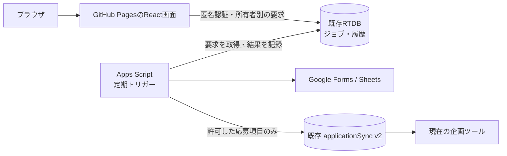

# フォームメーカー基盤の再設計案（無料運用を前提）

更新日: 2026-10-15（日本時間）
状態: 実装中。無料枠の候補をローカルで実装し、専用workerのpaused運転を確認した。公開フォーム作成、本番DB job書込み、RTDBルール公開は未実施。

## 1. 方針の訂正

これまで無料でできていた処理を直すために、有料サービスを必須にする理由はない。前案でCloud Functions、Cloud Tasks、Cloud Scheduler、Secret Managerを標準構成にしたのは設計上の選択であり、今回の不具合が要求するものではなかった。この必須条件を撤回する。

既存のGitHub Pages、Apps Script、Firebase Realtime Databaseと匿名認証を使う無料枠内の案を第一候補とする。無料枠は無制限ではないため、現在の利用量と追加処理の実測を採用条件にする。Blazeへの変更や有料サービスへの自動移行は計画に含めない。

目的は、GoogleのブラウザセッションでApps Script画面が開けない場合でも、フォーム入力画面を表示できること、作成結果・履歴・応募同期を失わないこと。Googleフォーム、回答シート、企画、参加者、車割り、精算を一括で作り直す計画にはしない。

## 2. 観測と未解明事項

以下は前段の調査記録に基づく。実行時には再確認する。

| 項目 | 確認できたこと／限界 |
|---|---|
| 現行の入口 | ポータルの `/form-maker/` はApps Script Bをiframeで表示し、履歴の応答を待つ |
| 利用中のセッション | iframeと直接リンクの両方でGoogleの「現在、ファイルを開くことができません」を観測した |
| 別の無ログイン環境 | 同じBを直接・埋め込みの両方で開けた |
| 原因 | アカウント／セッション依存の症状は確認済み。Google内部の原因を特定したわけではない |
| 過去の修復 | 別Script ID・v26のorigin修正と、現行B v43の障害を同一視しない |
| A/B | 同じScript ID `1m39W74vR_dyz05yuL24tjym8hdjUxS9NoLev5qWnPsDcYqCh41LG7Sjl` の別デプロイ。調査時点はA v41、B v43 |
| サーバー処理 | createForm・定期同期の失敗記録が別途ある。401/403や実行例外は画面の分離だけで解決したとみなさない |
| 復旧リンク | PR #18はタイムアウト後の導線を追加した。直接リンクも失敗する環境では根本修復にならない |
| 編集中の候補 | form-builderの未コミット変更は公開版と別。差分を保全し、一括pushしない |
| 他の呼出し元 | circleの書類出力には旧Aへの依存がある。ポータルだけの変更で移行完了としない |

根拠文書: form-builderの `docs/deployment-source-map.md`、`docs/releases/2026-10-15-form-maker-local-candidate.md`、ポータルの過去の履歴復旧計画、公開ブラウザの観測記録。

## 3. 無料案の比較

| 案 | 費用方針 | 特性／判断 |
|---|---|---|
| 現行の埋め込みを補修 | 既存サービスのみ | 最小変更。ただし利用者のGoogleセッションへの起動依存は残る。恒久案の第一候補にはしない |
| 静的UI＋RTDBジョブ＋Apps Script定期処理 | 既存サービスの無料枠内 | 第一候補。画面起動をGoogleから分離できる。作成開始は次の定期実行まで待つ可能性がある |
| 上記＋Cloudflare Workers Freeの中継 | 無料プラン限定の追加候補 | 即時起動の可能性を実証する選択肢。新サービス・認証・通信の複雑さが増えるため標準採用しない |
| 有料Functions等 | 前案を撤回 | 今回の要件で必須ではない。無料案の実測前に採用しない |

無料であることと待ち時間は別の判断とする。既存サービスだけの案で待ち時間が受け入れられなければ、無料中継の実証または改修範囲の縮小を比較する。「料金を払うしかない」と結論づけない。追加の無料サービスも実行時に選択を確定するまでは作成しない。

## 4. 第一候補の構成

### 4.1 画面と履歴

- URLは `/sanpokai-kikaku-portal/form-maker/` を維持。UIの正本をポータルの `src/features/form-maker/` に置き、Apps Scriptのiframeと `google.script.run` に依存させない。
- 既存候補のCarbon UI、黒いヘッダー、テーマ、送信ロック、コピー通知、完了見出しへのフォーカスを再利用する。
- 入力、認証、履歴、作成状態を分離する。履歴の失敗で入力画面全体を塞がない。認証不能なら作成操作だけを理由付きで止める。
- 作成後の履歴は所有者別RTDBに保存。ポータルも同じ履歴を読むため、埋め込み画面の準備完了通知を待たない。
- localStorageはキャッシュと旧履歴の読取りに使う。旧履歴を消さず、formIdやメール一致だけでサーバーの所有権を作らない。
- 履歴を非表示にしても実フォーム・回答・企画を削除しない。無効日時を1970年として表示しない。
- `projectUrl` と `responseSheetUrl` は分離する。旧 `spreadsheetUrl` の別名処理は旧履歴adapterだけに置く。
- 企画リンクは別タブで一度だけ開き、元のフォーム画面を遷移させない。

### 4.2 認証とDBの境界

- 初期段階は端末単位のFirebase匿名認証。端末間復元や認証情報消失後の回復は保証しない。
- ポータルとcircleの連携用には固定名 `sanpokai-form-maker-v1` のFirebase Appを使う。circleのroom単位の一時Appとは分離し、roomの終了で連携用AuthをsignOutしない。
- 新namespaceは `/formMakerV1/users/{uid}/jobs/{jobId}` と `history/{formId}`。全体の処理台帳・フォーム登録簿はworker専用とする。重複したpending索引は持たない。
- clientは自分の未受付要求をETag付きconditional PUTで一度だけ作成できる。同じjobIdへの競合はFirebaseが412で拒否する。状態・結果・所有権・実フォームIDはworkerだけが更新する。
- workerは取得したjobのUID・ID・inputHash・状態を再検証し、不正データを処理しない。別pending索引は持たない。
- workerは専用のFirebase Auth UIDと最小権限のルールでREST接続する候補。資格情報はScript Propertiesに置く。匿名認証RESTによる発行・更新・失効を事前検証する。既存の失敗したrefresh tokenをそのまま流用しない。
- ルールの正本はcircleの `firebase/database.rules.json`。既存roomに親の広い許可がある以上、子のdenyで完全なworker専用書込みを保証できるとは書かない。ジョブ・履歴はroom外に置く。
- 匿名UID単位の制限だけでは新UIDによる乱用を止められない。全体の作成上限・未処理上限・入力検査をworkerで行う。公衆向け受付の悪用対策が不十分なら新規公開を止め、無料で可能な受付制限を再設計する。

### 4.3 Apps Scriptの処理

- Google操作主体は `sanpokai.formmaker@gmail.com`、Firebase管理は `610unko@gmail.com` を維持。
- 旧A/BのHEADやトリガーへの巻き込みを避け、新処理専用Scriptを候補とする。作成は実行段階。別Scriptにしても同一Googleユーザーの割当は増えない。
- 定期トリガーがRTDBの要求を読み、Googleフォーム作成、シート接続、編集者共有、企画初期化、結果記録を行う。基本案には公開Web APIやHMAC中継は不要。
- 1分トリガーを候補とするが、必ず60秒以内に開始する保証ではない。空キュー確認を軽くし、作成・同期に処理時間と件数の上限、公平なcursor、backoffを持たせる。
- 権限・トークン・ルールの失敗時は受付済み要求と資産を残す。新しい匿名workerへ自動切替えしたり、無限に再試行したりしない。
- トリガーは固定Webデプロイ版ではなく保存済みコードを実行する。公開管理では実行コードのhash、Script ID、トリガー所有者・設定を記録する。バージョン番号だけで再現可能とみなさない。

### 4.4 二重作成と部分成功

- client UUIDをjobIdとして入力hashと結び付ける。同じjobへの再送で別フォームを作らない。要求は作成後に編集できない。
- `queued / running / completed / partial / failed / unknown` を永続化する。受付・処理待ち・作成中を正確に表示する。
- Googleの作成とDB保存は原子的ではない。作成直前の台帳、jobId入り初期タイトル、取得formIdの即時記録で復旧する。
- 作成直後の通信消失はmarker検索と台帳を照合する。既存資産が不明なときは `unknown` を維持し、自動で作り直さない。exactly-onceを保証しない。
- シート・共有・企画初期化の失敗は個別に保存。フォームができていればリンクを返し、未完了の処理だけ再開する。

### 4.5 応募同期と書類出力

- 応募連携は `rooms/{projectId}/meta/applicationSync`、`formApplicationSync` v2、既存response keyを維持。room全体を上書きしない。
- 許可項目は `id/name/grade/canDrive/capacity/updatedAt`。学籍番号、学部・学科、LINE表示名、自由記述、車の備考を通常DB・ログへ追加しない。
- 読取り失敗を0人として書かない。同件数の編集・削除も検出する。参加者・車割り・精算を同期で変更しない。
- 書類出力は別の移行項目。新フォームを旧AのJSONPへ誤送信しない。新経路案は所有者別の出力ジョブで、workerが既定の編集者メールだけに共有したDriveファイルを作る方式。内容はRTDBに置かず、選択response keyを最大200件まで検証する。同名で推測しない。専用workerの現在のFormResultには引継ぎ権限がなく、既存CSV経路は旧AのJSONPとtoken hash metadataに依存するため、新規フォームは書類出力未対応として扱う。
- ファイル取得時のGoogleログインは入力画面の起動依存と別。ダウンロード操作の変化、共有権限、保存期間を検証して採否を決める。成立しなければ書類出力移行は未完了と記録し、新フォーム全面切替えをしない。
- 旧フォームのhandoff token・A経路は互換対象として保全する。UIの変更だけで書類出力も移行済みとはしない。
- **実装時の判断:** PとCは別originなのでFirebase匿名UIDを共有できない。Task 6の固定名Auth共有案は採用せず、既存の引き継ぎcapabilityを出力jobで検証する。jobにはtoken本体を含めずSHA-256だけを渡し、workerがフォームmetadataのhashと照合する。C RTDB EmulatorにUID別jobと、PIIを含むresultを拒否する契約を追加した。worker・新フォームtoken発行・UIが揃うまでは経路を利用可能としない。

## 5. 無料枠と応答速度の検証

無料枠内に収まることは、利用量を測る前には断定しない。以下は課金への同意を求める条件ではなく、無料案の採否を決める条件。

| 対象 | 検証内容 |
|---|---|
| Apps Script | 既存トリガーとの合計実行時間、URL Fetch、作成件数、同時実行、Properties容量 |
| RTDB/Auth | 現在の料金プラン、接続数、保存容量、転送量、匿名認証の設定と要求制限 |
| 作成待ち | 空キュー・連続要求・既存同期中の待ち時間を実測。1分間隔を保証時間と書かない |
| 同期 | 健康時の合成回答から企画表示まで3分以内を初期の受入目標とし、製品保証と区別 |
| 受付上限 | 全体・UID別の日次作成数と未処理数を利用実態から設定。上限時は明示的に受付停止 |
| テスト環境 | 原則Emulatorと専用テスト資産。別クラウドprojectの新設を必須にしない |

待ち時間が不合格なら、任意のCloudflare Workers Free中継で署名付きの即時起動を実証できる。無料のCPU・リクエスト制限、認証検証、Apps Scriptへの応答を実測し、耐久性はRTDBジョブと定期処理が担う。Workerの `waitUntil` に長時間処理を任せない。有料Queues等を追加しない。これは選択肢であり、無料運用に必須ではない。

## 6. 公式仕様と設計判断

| 公式資料 | この計画の判断 |
|---|---|
| [Apps Scriptの複数ログイン制約](https://developers.google.com/apps-script/guides/support/troubleshooting#issues-multiple) | Googleのブラウザセッションに画面起動を依存させない。今回の内部原因を断定しない |
| [定期トリガーのeveryMinutes](https://developers.google.com/apps-script/reference/script/clock-trigger-builder#everyMinutes(Integer)) | 既存サービスだけの処理起動候補にする。実際の遅延を検証する |
| [Apps Scriptの割当](https://developers.google.com/apps-script/guides/services/quotas) | 同じ実行者の既存処理と合算して測定する |
| [Firebase料金・無料枠](https://firebase.google.com/pricing) | 無料枠内を条件とし、Blaze移行を必須にしない |
| [Firebase匿名認証](https://firebase.google.com/docs/auth/web/anonymous-auth) | 端末単位の識別に利用。本人確認・端末間復元とは区別する |
| [RTDBルールの継承](https://firebase.google.com/docs/database/security/core-syntax) | 新しいprivate namespaceを設け、既存roomの権限制約を過大評価しない |
| [Apps Scriptのデプロイ種別](https://developers.google.com/apps-script/concepts/deployments) | Web公開版とトリガーの実行ソースを区別する |
| [Workers料金](https://developers.cloudflare.com/workers/platform/pricing/)、[制限](https://developers.cloudflare.com/workers/platform/limits/) | 無料中継は任意の実証候補。無料だから無制限・無期限実行と考えない |

## 7. 段階移行と完了条件

最初は専用テストフォーム、その後は新規フォームだけを新経路へ送る。既存フォームを一件移す際は旧writerの停止と実行終了を確認してから新writerを有効にする。フォーム・シート・room・回答IDを変えない。未コミット候補全体を旧A/Bへpushしない。

完了には、同じrelease記録と同じ専用テスト企画で、現在の複数Googleログイン済みサイドブラウザの起動、作成、共有、履歴、架空回答、Firebase同期、企画表示、書類出力をそれぞれ確認する。連打・再読込み・通信切断・履歴失敗・別UID拒否も確認する。390px、テーマ、キーボードを確認し、Safari／VoiceOver実機の未検証を別のブラウザ成功で埋めない。

課金サービスを追加せず、実測した待ち時間・無料枠・受付制限が運用条件を満たすことも採用条件とする。満たさなければ無料案の構成か範囲を見直し、自動で課金へ進まない。

実装手順: [無料運用を前提とした実装計画](../plans/2026-10-15-form-maker-foundation-rebuild-plan.md)。今回はこの計画の修正まで。
